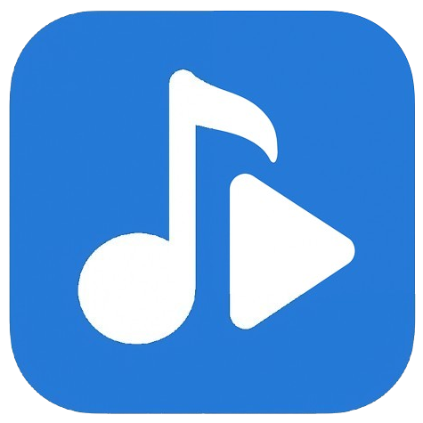

<p align="center"></p>

# LyricsPlayer · WPF

음악과 가사를 함께 감상하는 Windows x64 데스크톱 플레이어입니다. .NET 8, 네이티브 WPF/XAML, LibVLC를 사용합니다. WinForms 및 WindowsFormsHost를 사용하지 않습니다.

## 실행과 파일 배치

배포 폴더 전체를 풀고 `LyricsPlayer.exe`를 실행하세요. Self-contained 게시에는 .NET Desktop Runtime이 포함되므로 별도 .NET/VLC 설치가 필요하지 않습니다. Windows 10/11 x64를 대상으로 합니다.

자동 검색 위치는 Windows의 **동영상(Videos) 특수 폴더 하위 `LyricsPlayer`**입니다. 일반적인 위치는 `%USERPROFILE%\Videos\LyricsPlayer`이며, Windows에서 동영상 폴더를 이동했다면 그 위치를 따릅니다. 하위 폴더는 재귀 검색하지 않습니다. 폴더가 없으면 생성합니다.

```text
Videos/LyricsPlayer/
  Song.mp4
  Song.lrc
  Another song.mp3
  Another song.srt
```

- 미디어: **MP4, MP3, WMV, MKV**. 확장자는 대소문자를 구분하지 않습니다. 실제 디코딩 가능 여부는 파일 내부 코덱과 손상 여부에 달려 있습니다.
- 가사: 동일 경로·동일 파일명의 **LRC 또는 SRT**. 둘 다 있으면 LRC를 우선합니다. 가사가 없어도 재생됩니다.
- LRC: 다중 타임스탬프, `mm:ss.fff`/`hh:mm:ss.fff`, 동일 시각 번역 병합 지원.
- SRT: 종료 시각, 여러 줄 자막, 번호가 없는 블록 지원.
- 라이브러리 밖의 파일도 파일 열기 또는 드래그 앤 드롭으로 재생할 수 있습니다. 여러 파일을 놓으면 첫 번째 지원 미디어를 엽니다. 파일을 라이브러리로 복사하거나 이동하지는 않습니다.

## 조작

재생목록 항목을 더블클릭하거나 Enter로 재생합니다. 하단에서 이전/다음, 재생/일시정지, 정지, 위치, 볼륨, 속도를 조절할 수 있습니다. 가사를 클릭하면 해당 시작 시각으로 이동합니다. 가사 위아래 화살표는 이전/다음 가사로 탐색합니다.

| 입력 | 동작 |
|---|---|
| Space | 재생/일시정지 (텍스트 편집 중 제외) |
| Left / Right | 5초 뒤/앞으로 탐색 (컨트롤 자체 키 동작은 유지) |
| Ctrl+Left / Ctrl+Right | 이전/다음 곡 |
| Ctrl+O | 파일 열기 |
| Ctrl+F | 검색창 포커스 |
| Ctrl+P | 가사 PiP |
| F11 / 영상 더블클릭 | 전체화면 전환 |
| Esc | 전체화면에서 복귀 / PiP에서 닫기 |
| 가사 휠·스크롤바 | 수동 스크롤, 입력이 멈추면 약 3초 뒤 자동 복귀 |

가사 시간 보정의 기본값은 **+200ms**입니다. 가사 영역 하단에서 -10000~10000ms 범위로 바꿀 수 있습니다. 양수는 가사를 더 일찍 표시합니다. `초기화`는 +200ms로 복귀합니다. 가사 클릭은 보정값을 더하지 않은 원래 시작 시각으로 탐색합니다. 설정은 실행 세션에만 적용됩니다.

현재 가사는 **음악의 저음에 따라 최대 12.5% 추가 확대**됩니다. Playlist Canvas와 같은 곡별 정규화·빠른 상승(60ms)·느린 감쇠(400ms에 90% 복귀) 곡선을 사용하며, 요청에 따라 확대 강도는 해당 기본값의 절반으로 줄였습니다. 현재 줄의 기본 강조(1.08배)와 주변 줄의 투명도는 360ms에 걸쳐 전환됩니다. 가사 이동도 360ms의 부드러운 곡선을 사용합니다. LibVLC로 오디오만 미리 분석한 뒤 재생 시각에 맞춰 반응 값을 읽으므로, 실시간 감지 결과를 뒤늦게 재생하는 대기열이 없습니다. 메인·전체화면·PiP는 같은 시간과 반응 곡선을 공유합니다. 마이크·시스템 오디오 캡처나 별도 분석 프로그램 설치가 필요하지 않으며 Windows 10/11에서 사용할 수 있습니다. Windows 클라이언트 애니메이션을 끄면 음악 확대를 생략합니다. 구현과 검증은 [음악 반응 기록](docs/AUDIO-REACTION.md)을 참고하세요.

재생 중에는 LibVLC의 시간 보고 사이를 단조 시계로 보간해 가사 전환이 멈췄다가 뒤늦게 따라오는 현상을 줄입니다. 일시정지·버퍼링·속도 변경·탐색에서 시계를 재조정하며, 기본 +200ms 보정은 유지합니다. 원본 가사 파일이나 출력 장치 자체의 지연은 시간 보정으로 조절할 수 있습니다.

검색은 **화면에 표시되는 곡만** 필터링합니다. 이전/다음과 자동 다음 곡은 파일명을 기준으로 정렬된 전체 라이브러리 순서를 따릅니다. 첫 곡 이전과 마지막 곡 이후로 순환하지 않습니다. 라이브러리 밖의 파일이나 목록에서 없어진 파일을 재생 중이면 다음 곡은 라이브러리 첫 곡입니다. 재생목록에서 단순히 선택한 항목과 실제 재생 곡의 강조는 구분됩니다.

파일의 추가·변경·이름 변경·삭제는 350ms 디바운스 후 반영합니다. 메타데이터는 비동기로 읽으며 기존 목록 항목과 검색어를 유지합니다. 파일 위치는 우클릭 메뉴로 엽니다. 플레이어에서 파일을 삭제하지 않습니다.

PiP는 같은 재생 세션과 가사를 공유하는 항상 위 창입니다. 상단을 드래그해 이동하고 모서리로 크기를 바꿉니다. 전체화면은 **동일한 메인 창과 영상 HWND를 유지**하며 영상과 가사를 나란히 확장합니다. 3초간 활동이 없으면 컨트롤이 사라지고 마우스·키보드 입력 시 복귀합니다. 탐색 중에는 숨기지 않습니다.

## 빌드와 검증

Windows의 .NET 8 이상 SDK가 필요합니다. 대상 프레임워크는 `net8.0-windows`로 유지합니다.

```powershell
dotnet restore
dotnet build -c Release
dotnet run --project Tests/LyricsPlayer.Checks.csproj -c Release
```

실제 재생·창 전환 검사는 FFmpeg로 만든 테스트 미디어가 필요합니다. 기존에 설치된 FFmpeg의 경로를 넘기세요. 생성 파일은 `artifacts/test-media`에만 저장됩니다. 개인 미디어 폴더는 테스트 데이터로 수정하지 않습니다.

```powershell
./tools/New-TestMedia.ps1 -FFmpeg C:/tools/ffmpeg.exe
dotnet run --project Tests/LyricsPlayer.Checks.csproj -c Release -- --runtime
```

참조 곡선과의 수치 비교·음악 반응·가사 경계 시각·PiP·4개 형식 분석·분석 취소·대량 가사 렌더링을 검사하려면 `--runtime` 대신 `--audio-runtime`을 사용하세요. 이 검사는 전체화면으로 전환하지 않습니다. `--hold`를 덧붙이면 생성된 리듬 미디어를 재생하며 60초간 시각 확인 창을 유지합니다.

회귀 검사와 남은 수동 검증 항목은 [마이그레이션 검증 기록](docs/WPF-MIGRATION.md)을 참고하세요. 자동 검사 성공은 모든 GPU·DPI·모니터 조합의 검증을 뜻하지 않습니다.

`--runtime`은 실제 창을 전체화면으로 전환합니다. 자동 숨김 검사 중에는 테스트 창 위의 마우스 이동을 멈추세요. 실제 입력이 계속되면 3초 대기 시간이 재시작되어 검사 시간이 초과될 수 있습니다.

## 배포

```powershell
dotnet publish LyricsPlayer.csproj -c Release -p:PublishProfile=Portable-win-x64
```

기본 출력: `artifacts/publish/win-x64/`. **폴더 전체를 배포**하세요. `libvlc/win-x64/libvlc.dll`, `libvlccore.dll`, `plugins/`를 포함해야 합니다. 실행파일만 다른 곳으로 복사하면 재생할 수 없습니다. WPF와 LibVLC 플러그인 로딩을 보존하기 위해 trimming과 단일 EXE 게시를 사용하지 않습니다. ZIP으로 묶어 배포할 수 있습니다. 디지털 서명·설치 프로그램·자동 업데이트는 포함하지 않습니다.

## 구조와 의존성

- `Core/LyricTimeline.cs`: 기존 이진 탐색, 200ms 보정, 3초 초과 공백 규칙.
- `Parsers/`, `Models/LyricLine.cs`: 기존 파서와 가사 모델 재사용.
- `Services/`: LibVLC 세션, 가사 파일 읽기, 폴더 감시와 목록 갱신.
- `ViewModels/MainViewModel.cs`: 메인·PiP가 공유하는 MVVM 재생 상태와 명령.
- `Views/`: XAML 메인 화면, 가상화된 가사, 하단 컨트롤, PiP, 디자인 토큰과 벡터 아이콘.
- `Tests/`: 외부 테스트 프레임워크 없이 실행 가능한 회귀 검사.

LibVLCSharp.WPF **3.10.1**, VideoLAN.LibVLC.Windows **3.0.21**을 명시적으로 사용합니다. WPF 호스트는 HwndHost 기반의 공식 구현입니다. 영상 위의 입력/빈 화면은 VideoView.Content의 공식 오버레이 경로를 사용하며, 재생 컨트롤과 가사는 영상 옆에 두어 Airspace 제약을 피합니다. [VideoLAN WPF 통합 설명](https://docs.videolan.me/libvlcsharp/docs/getting_started.html), [WPF 변경 기록](https://raw.githubusercontent.com/videolan/libvlcsharp/3.x/NEWS).

기존 WinForms 기준 버전은 Git 커밋 `44fb0d4d9774c7e38061052467ab54f288a76b96`에 보존되어 있습니다. 전환 브랜치는 `codex/wpf-migration`입니다. 검증 후 기존 UI/GDI/WinForms Timer 및 사용하지 않는 디자이너 리소스를 제거했습니다. 앱 아이콘과 GPL-3.0 라이선스는 유지합니다. LibVLC와 LibVLCSharp의 라이선스는 해당 프로젝트를 따릅니다.
